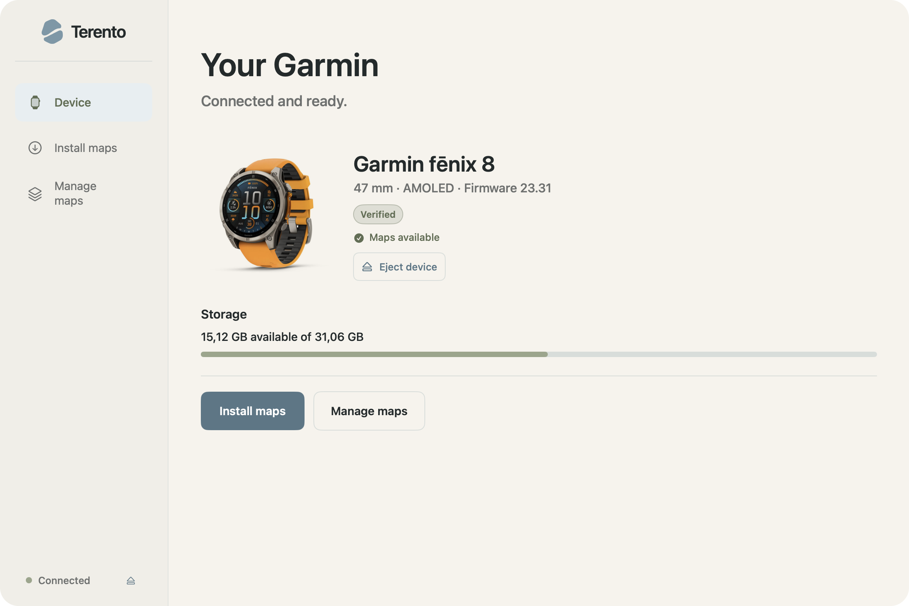
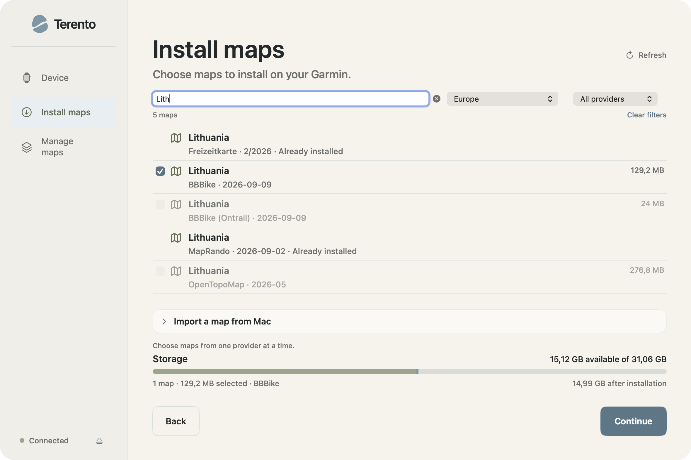
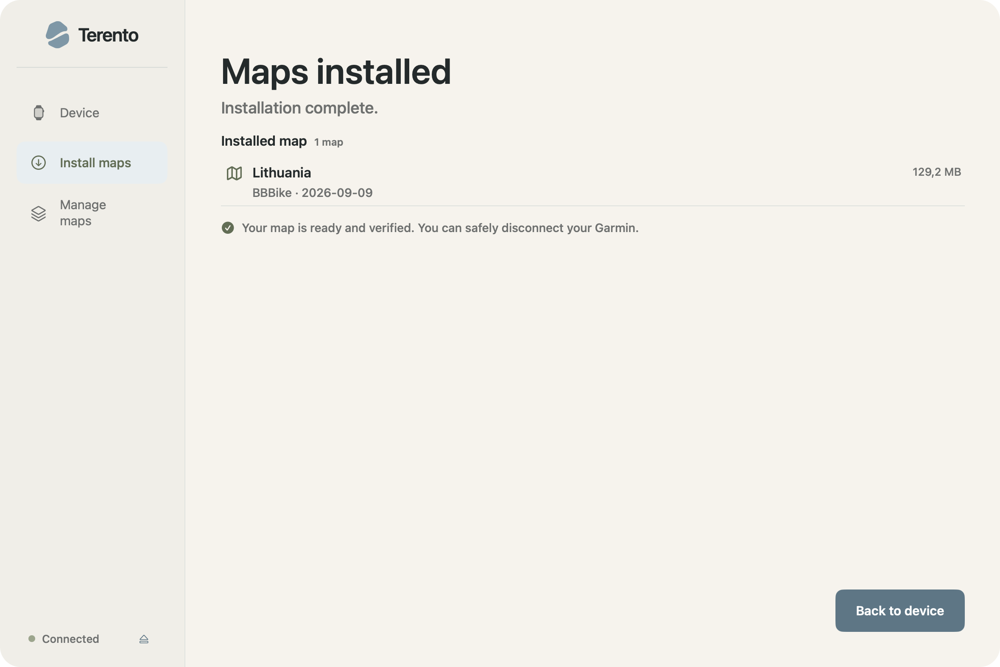
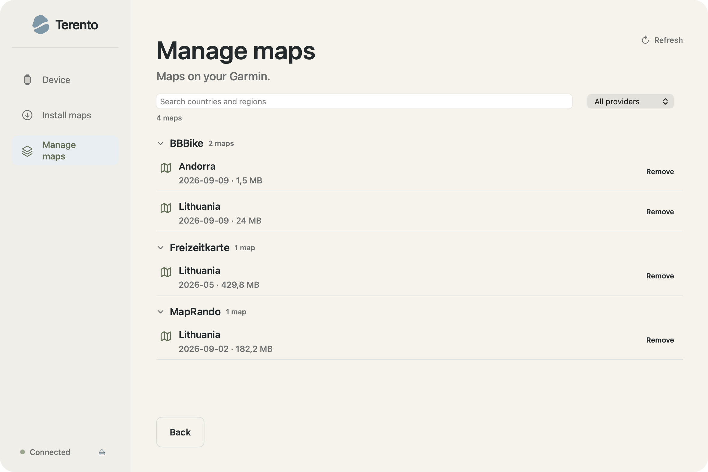
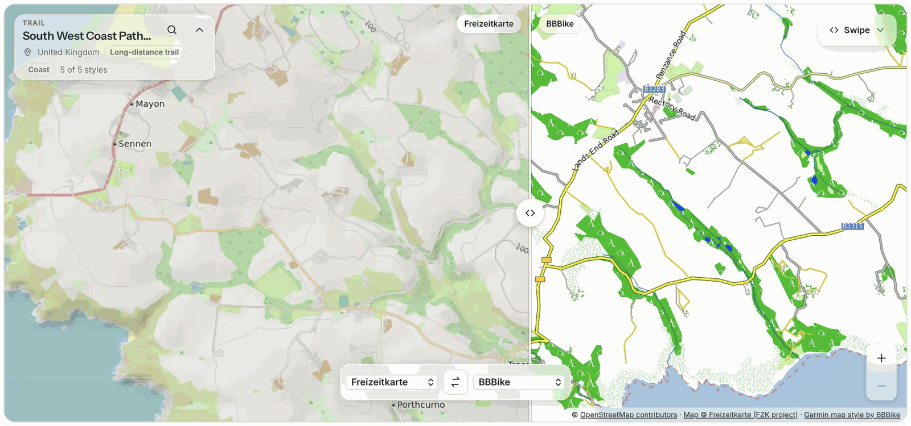
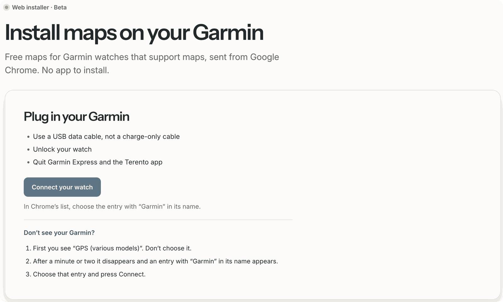

# Terento

> Install maps on Garmin watches, simply.

Get your Garmin ready for your next hike or ride. Connect your watch, choose a
map, and let Terento handle the download, installation, and transfer checks
from your Mac.

Terento is **free and open source**, built for Apple Silicon Macs and Garmin
smartwatches with map support. Choose from
[Freizeitkarte](https://www.freizeitkarte-osm.de/),
[OpenTopoMap](https://garmin.opentopomap.org/),
[MapRando](https://ravenfeld.gitlab.io/open-garmin-map/), and
[BBBike](https://garmin.bbbike.org), or import your own
compatible `.img` map.

**Connect → Install → Done**

**[Download for Mac](https://terento.app/download/?utm_source=github&utm_medium=referral&utm_campaign=repository&utm_content=readme_top_download)**
· [Check compatibility](https://terento.app/compatibility/?utm_source=github&utm_medium=referral&utm_campaign=repository&utm_content=readme_top_compatibility)
· [Mac installation guide](https://terento.app/guides/install-garmin-maps-mac/?utm_source=github&utm_medium=referral&utm_campaign=repository&utm_content=readme_top_guide)
· [Compare map styles](https://terento.app/map-styles/?utm_source=github&utm_medium=referral&utm_campaign=repository&utm_content=readme_top_map_styles)

**Free and open source · macOS 13+ · Apple Silicon**

On Linux? Try the [web installer beta](#web-installer-beta) in Google Chrome, Microsoft Edge, Opera or Brave.

  

## Get the maps you need, with less setup

- **Find your destination.** Search countries and regions, filter by continent
  or provider, or import a compatible map from your Mac.
- **Install with confidence.** Terento checks available space, downloads from
  the original provider, and verifies the transfer to your watch.
- **Keep your maps organised.** See installed maps by provider, find available
  updates, and remove maps you no longer need.
- **Protect what is already there.** Original Garmin maps and unknown files
  remain protected. Updates replace only Terento-managed maps.

Removing a recognized third-party map that Terento did not install requires
separate confirmation.

## How it works

1. **Connect.** Plug in your watch with a USB data cable. Terento recognizes it
   and checks whether you can continue safely.
2. **Install.** Choose a region from the catalog or add your own compatible
   `.img` map. Terento handles the installation and verification.
3. **Done.** Wait for confirmation, safely disconnect your watch, and check
   that the map is available on it.

  

  

See map management

  

## Compare map styles

Not sure which map to choose? The
[map style comparison](https://terento.app/map-styles/?utm_source=github&utm_medium=referral&utm_campaign=repository&utm_content=readme_map_styles)
shows how the five map styles draw the same place. Pick a mountain area,
trail or city, then compare contour lines, trails, streets and labels side by
side or with a swipe.

Previews are close, not exact: your watch draws the map itself, so colours
and detail can differ with the watch model and its map settings.

  

## Web installer (beta)

The web installer puts maps on your watch from Google Chrome, Microsoft Edge,
Opera or Brave on a computer, without installing the app. Firefox and Safari
can't connect to USB devices. It works on a Mac and on Linux. It does not work
on Windows yet: with Windows' own watch driver, no browser can open the watch.

**[Open the web installer](https://lab.terento.app/install/)**

1. Plug in your watch with a USB data cable and unlock it. Quit Garmin
   Express and the Terento app.
2. Choose **Connect your watch**. In the browser's list, first you may see
   "GPS (various models)". Don't choose it. After a minute or two an entry
   with "Garmin" in its name appears. Choose that one.
3. Choose maps and install them.

So far maps have been installed with the web installer only with a fēnix 8
47 mm on a Mac in Google Chrome. On Linux, the browser may first need USB access to the watch; the
page shows a one-time command for that. Other watch models are not confirmed
yet.
If you try it, please
[tell us how it went](https://github.com/VooZ2/terento/issues), whether it
worked or not.

In the web installer, Terento's server downloads each map from its provider
and passes it to your browser; the copy is deleted once your browser has it.
The web installer is a separate beta: its code is not part of this
repository. See the
[Privacy Policy](https://terento.app/privacy/?utm_source=github&utm_medium=referral&utm_campaign=repository&utm_content=readme_web_installer_privacy)
for what it records.

  

## Requirements and compatibility

- macOS 13 or later on an Apple Silicon Mac; Intel Macs are not supported.
- A Garmin smartwatch with map support.
- A USB cable that supports data transfer.
- An Internet connection for downloading catalog maps.

Compatibility is evaluated for each exact model and variant using real
installation evidence. The Compatibility page is a successful-installation
directory: it shows exact Garmin models and variants with at least one
successful shared installation. The list grows as more successful
installations are shared, and a model missing from the list does not mean it
is unsupported. Terento is intended for Garmin smartwatches with map support.

**[Check your watch's compatibility](https://terento.app/compatibility/?utm_source=github&utm_medium=referral&utm_campaign=repository&utm_content=readme_compatibility)**

Evidence for one model does not establish compatibility with every Garmin
watch. Handheld GPS devices, Edge cycling computers, and automotive devices
are outside the current public scope.

## Download and release status

The latest public release is **1.0.1 (build 45)**, a fix release for Terento
1.0.0. Download the notarized macOS app below; no additional software is
required.

**[Download Terento](https://terento.app/download/?utm_source=github&utm_medium=referral&utm_campaign=repository&utm_content=readme_download)**

Temporarily unavailable maps remain visible with a reason. Install and Update
are disabled until downloads are available again; installed maps remain usable.

DMG, ZIP, release notes, and previous versions are available on
[GitHub Releases](https://github.com/VooZ2/terento/releases).

Compatibility is still evaluated model by model. Updates to newer BBBike and
MapRando releases were confirmed on a real watch; Freizeitkarte and OpenTopoMap
updates, the faster update checks of rc.1 and the recovery fixes of rc.3 still
need real-device confirmation. Of the connection messages of rc.2, only the
busy-watch message has been checked on a real watch.

During an update, Terento checks the new map before removing the old version
it installed. If there is not enough space for both, it stops and keeps the
working map. Terento does not keep a backup of your maps on your Mac.
Some watches may need to be reconnected if detection or map listing stalls.

## Maps

The current catalog includes main-map packages from
[Freizeitkarte](https://www.freizeitkarte-osm.de/),
[OpenTopoMap](https://garmin.opentopomap.org/),
[MapRando](https://ravenfeld.gitlab.io/open-garmin-map/), and
[BBBike](https://garmin.bbbike.org), based on OpenStreetMap data.
BBBike offers two map choices: BBBike and the smaller BBBike (Ontrail)
packages for hiking and cycling. In the Mac app, maps download directly from
their providers.

- Install several regions together by choosing maps from the same provider.
- Some MapRando map labels are in French.
- OpenTopoMap contour lines are an optional add-on. Choose whether to include
  them when installing a region in Terento; the main map works without them.
- Import compatible `.img` maps from your Mac. Terento cannot check these
  maps for updates. A single map file must be smaller than 4 GB.
- Maps for Russia and Crimea are not offered in Terento. Maps already on a
  watch are not automatically removed.

## Privacy

No account or cloud device profile is required.

Compatibility reports and map-usage diagnostics are enabled by default.
You can turn either off in
`Terento → Diagnostics` without affecting installation. Custom map imports
contribute only to compatibility diagnostics, never map-usage diagnostics.

Reports exclude Garmin Unit IDs, serial numbers, accounts, local file paths,
map files, and raw diagnostic logs. Infrastructure partners may process IP
addresses and request metadata. Uploaded reports cannot be deleted from the app.

See the [Privacy Policy](https://terento.app/privacy/?utm_source=github&utm_medium=referral&utm_campaign=repository&utm_content=readme_privacy)
for report fields, retention, and privacy-rights requests.

## Why I built Terento

I enjoy mountain hiking, and before a trip I like to get maps for the places
I'm visiting onto my Garmin. Finding the maps and the right Mac software was
often harder than it should have been. Terento grew out of wanting that to
feel simple. I'm keeping it free and open source so it can help the community.

[Read the story](https://terento.app/about/?utm_source=github&utm_medium=referral&utm_campaign=repository&utm_content=readme_about)
· [Support Terento](https://buymeacoffee.com/vooz2)

Donations are optional and do not unlock features, maps, or provider access.

## Help make Terento better

If installation fails, Terento offers to open a GitHub issue with the
diagnostic information needed to investigate. You can also
[open an issue](https://github.com/VooZ2/terento/issues) directly.

Include your exact watch model and variant, Terento version, what you tried,
and what happened. A report that a map installed and works on your watch is
useful too.

For connection, storage, download or leftover-map problems, see the
[troubleshooting guide](https://terento.app/guides/troubleshooting/?utm_source=github&utm_medium=referral&utm_campaign=repository&utm_content=readme_help_troubleshooting).
For first-time setup and map visibility, see the
[Mac installation guide](https://terento.app/guides/install-garmin-maps-mac/?utm_source=github&utm_medium=referral&utm_campaign=repository&utm_content=readme_help_guide).

## Contributing

Bug reports, compatibility testing, documentation improvements, and focused
pull requests are welcome.

- [Contributing](CONTRIBUTING.md) — development setup, test suites, and safe device testing.
- [Brand guidelines](brand/BRAND_GUIDELINES.md) — visual and user-facing rules.
- [Security](SECURITY.md) — reporting security issues.
- [Packaging](Packaging/README.md) — build, signing, and release details.
- [Repository structure](PROJECT_STRUCTURE.md) — source code and component documentation.

## License and attribution

Terento source code is licensed under [GPL-3.0-or-later](LICENSE).
[Third-party notices](THIRD_PARTY_NOTICES.md) cover bundled dependencies;
provider maps and [OpenStreetMap data](https://www.openstreetmap.org/copyright)
retain their own licenses and attribution.

Terento is an independent open-source project and is not affiliated with,
endorsed by, or sponsored by Garmin.
